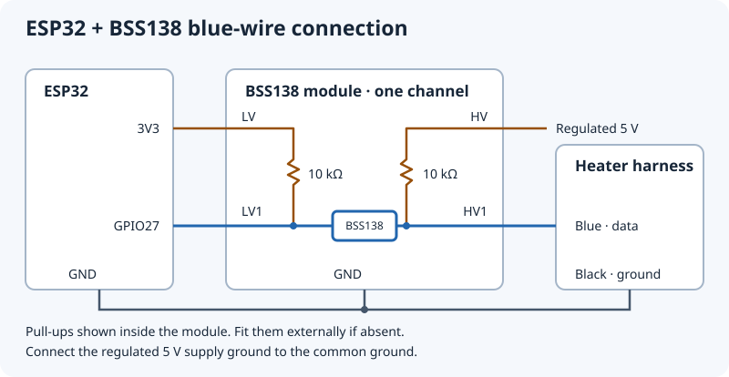

# Diesel heater blue-wire controller (ESP32 + BSS138)

Phone control and live status for a cheap Chinese diesel air heater - the kind with the simple LCD controller on a red / blue / black cable. It talks the heater's own single-wire protocol, works **alongside the original display** (or without it), and serves a web page from an ESP32 that any phone on your WiFi can open.

Thanks to JR ([valleyprn-stack](https://github.com/valleyprn-stack)) for building the original controller and documenting the blue-wire protocol. [Original project](https://github.com/valleyprn-stack/diesel-heater-bluewire-esp32).

**ESP32-only firmware v2.0.0.** The ESP32 runs both the blue-wire protocol and the web controller. A BSS138 bidirectional logic-level converter translates between the heater's 5 V blue-wire bus and the ESP32's 3.3 V GPIO. The port has passed simulated bus tests. Validation on a physical heater is pending.


## What it does

- **Start, stop, and set the level 1-6** from a phone. The original display stays plugged in and keeps working.
- **Live status decoded from the heater**: fan, glow plug, fuel pump, the actual phase it's in (fan up, preheat, ignition, running, shutdown, clearing, purge), the level, chamber temperature, and the supply voltage the OEM display shows.
- **Fault codes** (tentative E-number) and a START button that clears a fault, like the OEM display does.
- **Stats**: this run, how long it took to light, run time today, total hours, number of starts. Saved through power cuts.
- **Graph** of chamber temperature for the last hour.
- **Alerts**: fault, flame-out (glow plug coming back on mid-run, or the chamber dropping fast), slow ignition, not warming up, low / high battery.
- **Room sensor + auto modes** (DHT22): *Thermostat* holds a room setpoint by finding the power level that holds it ("smooth hold" - eases down on the way up, then trims one level at a time, remembers the level that worked); *Frost guard* starts at a low temperature, runs low, shuts off. Guard rails on everything: minimum run and rest times, max starts per hour, cold-night idle, no starts without a room reading. Every rail has its own switch.
- **Chamber guard**: if the chamber sits under a floor (default 120 °C) while lit it adds a level, so a low burn doesn't coke the heater.
- **Master shut-off**: room over 75 °F for a minute → heater off, in every mode. A long Manual run gets asked "keep it running?" and stops if nobody answers.
- **History page**: 24 h / 7 d / 30 d / year - run time by level, starts, light-up times, room low/high, shut-offs and faults. Kept on the ESP32's flash through power cuts.
- **Black box** (`/diag`): why it last restarted, uptime, lowest free memory, WiFi signal, last web request; watches its own loop and web server and restarts itself if they hang. An ESP32 restart never touches the heater.
- **Three page styles** you pick from a dropdown: a burner cutaway, an OEM-style 7-segment LCD, and a car-cluster gauge. °C / °F. Home-screen icon and web manifest, so "Add to home screen" looks right.
- **RGB LED light show** on boards that have one on GPIO16: heartbeat when idle, flickering flame that grows with the level, glow-plug throb, cooling glow, red fault flashes.
- **Over-the-air updates** for the ESP32, mDNS (`http://heater.local`), and a fallback WiFi hotspot.

Everything the pages need is built into the ESP32 - no internet, no app, no cloud.


## How the ESP32-only design works

```
Phone <-- Wi-Fi --> ESP32 <-- 3.3 V --> BSS138 <-- 5 V blue wire --> Heater
                                                  |
                                          Original LCD (optional)
```

The blue wire is a bidirectional, open-drain bus. Devices pull it low and release it so the pull-ups can restore the idle high level. A dedicated ESP32 task decodes the roughly 4 ms and 8 ms low pulses captured by the GPIO interrupt. The ESP32's RMT peripheral sends pulses on the same open-drain pin while Wi-Fi and the web UI run independently. With the LCD attached, the ESP32 sends commands in the quiet gap after the heater replies to the LCD. Without the LCD it sends its own heartbeat. See [the blue-wire protocol](docs/PROTOCOL.md) for frame timing and status decoding.

## Parts

- ESP32-WROOM dev board and a regulated 5 V supply, such as USB or a 12 V to 5 V converter.
- BSS138 bidirectional logic-level converter module. One channel is enough.
- Two **10 kΩ pull-up resistors** for a discrete BSS138 circuit or a module without onboard pull-ups. A module with 10 kΩ pull-ups on both sides already provides both resistors.
- Jumper wires.
- Optional DHT22 / AM2302 room sensor for auto modes. A bare four-pin DHT22 needs its own **10 kΩ** data pull-up to 3.3 V. Install Adafruit's DHT Sensor Library and Adafruit Unified Sensor for the ESP32 sketch.

## ESP32-only wiring



| Connection | Wiring |
|------------|--------|
| Low-side supply | ESP32 **3V3** → converter **LV** |
| High-side supply | Regulated **5 V** → converter **HV** |
| Low-side data | ESP32 **GPIO27** ↔ converter **LV1** |
| High-side data | Converter **HV1** ↔ heater **blue** wire. The original LCD can stay connected to the same bus. |
| Ground | Join ESP32 **GND**, converter **GND**, 5 V supply ground, and heater **black** wire. |
| Heater red wire | Leave it on the original display harness. Keep it separate from the converter's regulated 5 V supply. |
| Optional DHT22 | **+** → ESP32 **3V3**, **−** → **GND**, **data** → **GPIO32**. For a bare sensor, fit a **10 kΩ** resistor from data to **3V3**. |

Use one **10 kΩ** pull-up from **LV1 to 3V3** and one from **HV1 to regulated 5 V**. These resistors set the idle voltage on each side while allowing either end to pull the line low. This is the standard value on modules such as the [Adafruit BSS138 breakout](https://www.adafruit.com/product/757) and a starting value for the millisecond pulses on this bus. The heater and LCD can also contribute high-side pull-ups. Verify the idle levels and pulse edges on your heater before finalizing the circuit. The ESP32 GPIO must release the bus for a high level and drive it only to pull it low. For a discrete BSS138, connect the **gate to 3V3**, **source to LV1**, and **drain to HV1**. See [NXP application note AN10441](https://cdn-shop.adafruit.com/datasheets/AN10441.pdf).

## Setup

1. Wire the BSS138 and ESP32 as shown above. When upgrading from the original setup, disconnect the Nano from the blue-wire bus and remove the UART divider before connecting GPIO27 through the BSS138.
2. In Arduino IDE, open `firmware/heater_web_esp32/heater_web_esp32.ino` and set `WIFI_SSID` and `WIFI_PASS`. Select *ESP32 Dev Module* with the Arduino ESP32 core 3.x and install the two Adafruit sensor libraries listed above. Use a partition scheme with OTA and room for LittleFS. The default 4 MB scheme works.
3. Upload by USB. Open Serial Monitor at 115200 baud. It prints the IP address, followed by `[blue wire]` events when the bus task starts reporting.
4. Open the IP address or `http://heater.local` on your phone. If joining Wi-Fi fails, connect to the `HeaterCtl` hotspot (password `heater123`) and open `http://192.168.4.1`.

After the first upload, the ESP32 updates over WiFi: *Tools > Port > heater*. On Windows, set the WiFi network to Private and allow `espota.exe` through the firewall, or the upload sits at "No response from device".

## The chamber temperature

The heater reports a raw count, not degrees. `CAL[]` in the ESP32 sketch maps it to °C using readings taken off the OEM display's own chamber screen. If your heater's numbers differ, swap in your own pairs.

The OEM display only asks for chamber temperature while you're on its chamber screen, so the ESP32 polls it every 5 s while the heater runs or cools (button on the page: 5 s / 30 s / off).

## API

The pages use a small JSON API you can use too:

| Endpoint | |
|----------|-|
| `GET /api/status` | everything: state, phase, level, flags, chamber °C, volts, fault code, stats, alert, log |
| `GET /api/history` | last hour of chamber °C, one point per 15 s, plus a state letter per point |
| `GET /api/cmd?c=on\|off\|up\|down` | send a command |
| `GET /api/cmd?c=level&n=1..6` | step to a level |
| `GET /api/cmd?c=chamber&n=0..60` | chamber poll interval in seconds (0 = off) |
| `GET /api/unit?u=C\|F`, `/api/theme?t=burner\|lcd\|dash` | saved settings |
| `GET /api/auto?mode=manual\|thermo\|frost` | pick the mode; add any of `sp ease onBand offBand frostOn frostOff frostLvl minRun minOff coldRest mtMin thSmooth` to change a setting |
| `GET /api/keep?...` | answer the "keep it running?" prompt |
| `GET /api/hist?...` | history data behind `/history` |
| `GET /diag` | the black box log |

## Light show


## Repo layout

```
firmware/heater_bridge_nano/   Original Nano bus bridge, kept for reference and simulation
firmware/heater_web_esp32/     ESP32 blue-wire and web controller
    bluewire.cpp / bluewire*.h                  GPIO capture, RMT transmission and bus scheduling
    thermostat.h / safety.h / chamber_guard.h   auto modes, master shut-off, chamber floor
    histlog.h / diag.h / dht22.h                history on LittleFS, black box, room sensor
    web_*.h                                     generated pages (don't edit - see web_src)
    led_show.h                                  the LED engine
web_src/                       page sources - edit these, then run build_pages.py to regenerate web_*.h
tools/bus_sim/                 PC simulation of the bus (display + heater + bridge) to check timing changes
docs/                          protocol write-up and pictures
```

## Safety

This is a fuel-burning appliance. This project only sends the same button presses the original display sends - the heater's own controller still runs the burn, the safety shutdowns and the fault logic - but you are still remotely starting a combustion heater. Keep it installed properly with outside combustion air and exhaust, keep a CO alarm in the space, and don't run it unattended where that isn't safe. Use at your own risk.

## Still to do

- Try display byte `0x54` and see what the heater's answer means (see PROTOCOL.md).
- Verify GPIO27 timing, OEM display coexistence, and standalone operation on a physical heater.

## Credits

- [kellerman/vevor_pwm](https://github.com/kellerman/vevor_pwm) - an ESPHome take on the same pulse protocol; our bit values match theirs.
- [sashko2000/diesel-heater-esphome](https://github.com/sashko2000/diesel-heater-esphome) - a third independent decode of this bus, with a closed-form thermistor curve that agrees with our calibration table (details in PROTOCOL.md).
- [alxkalb/vevor-8kw-diesel-heater-esphome](https://github.com/alxkalb/vevor-8kw-diesel-heater-esphome) - their notes pointed us to the standby voltage, the phase flags and the fault words (they read the bits inverted).
- [zatakon/vevor_heater_control issue #7](https://github.com/zatakon/vevor_heater_control/issues/7) - the useful heads-up that the blue-LCD 3-wire controllers are not the 4800-baud UART kind.

Original project built by JR (valleyprn-stack) with Claude. MIT license.
